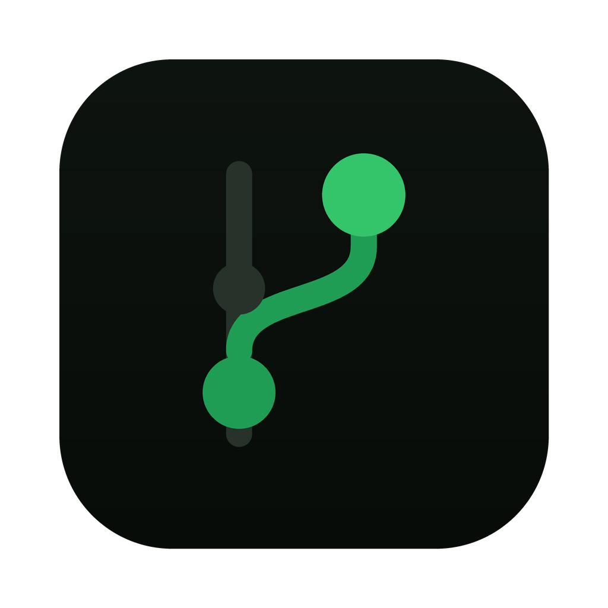
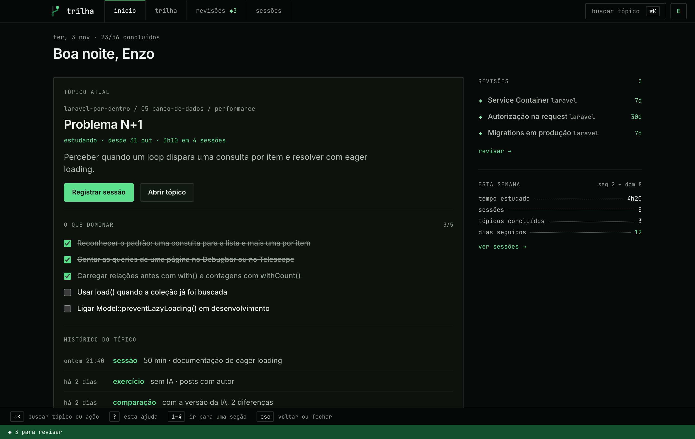
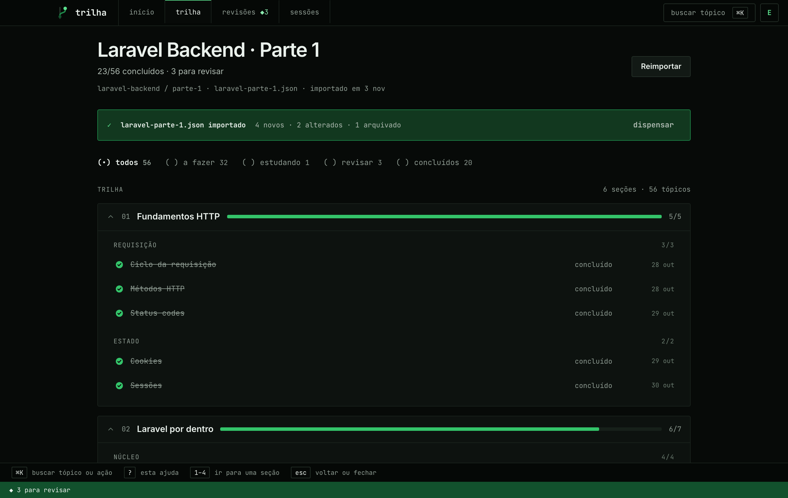
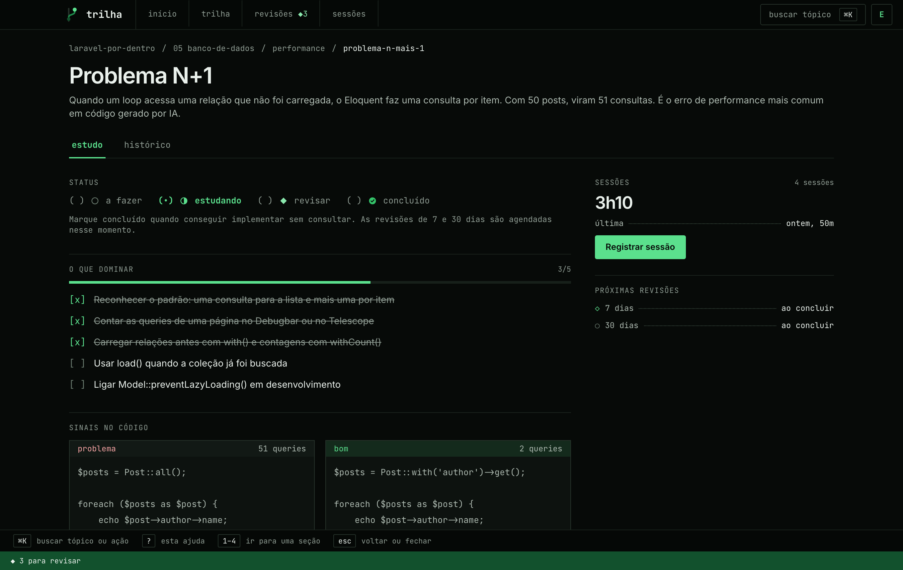
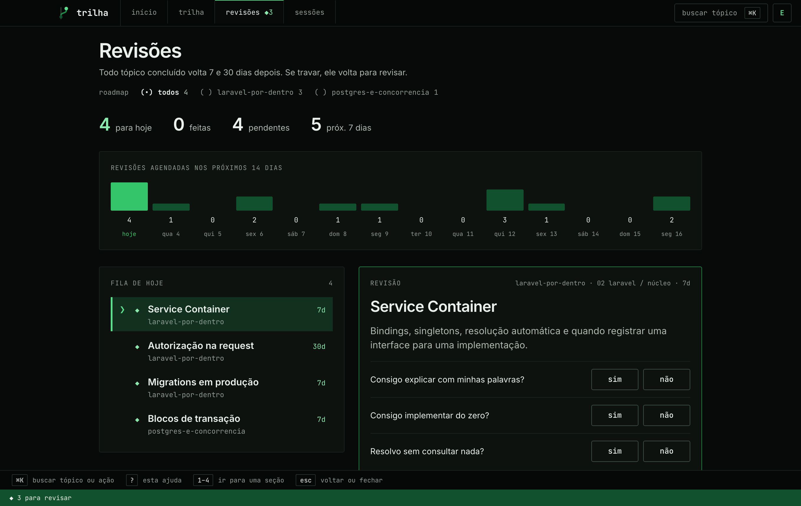
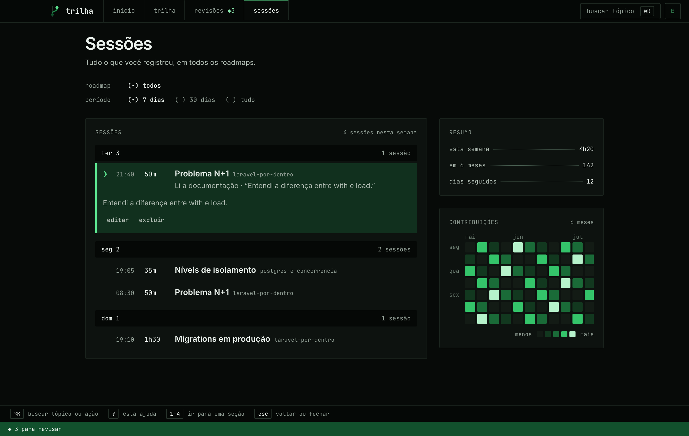
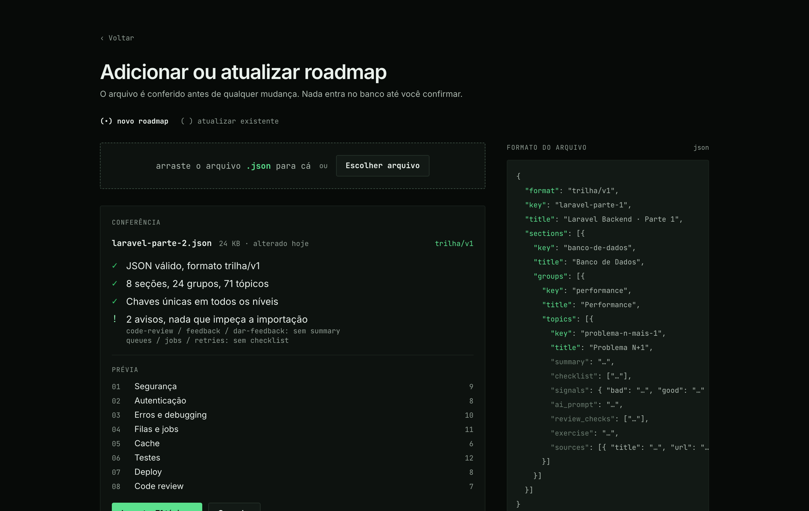
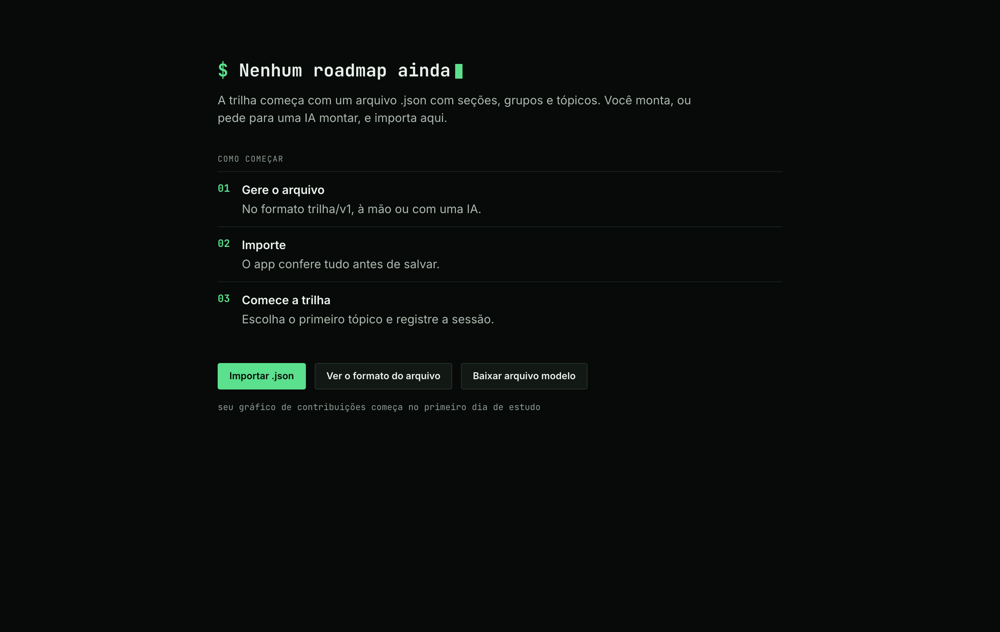

<p align="center">
  
</p>

<h1 align="center">trilha</h1>

<p align="center">
  A personal desktop app to follow a study roadmap topic by topic, log your study sessions and keep up with spaced reviews.
</p>

<p align="center">
  <a href="https://github.com/enzobreisc/trilha/actions/workflows/tests.yml"></a>
  
  
  
  
</p>

<p align="center">
  English · <a href="README.pt-BR.md">Português</a>
</p>



> [!NOTE]
> **v0.1.0 is a work in progress.** Roadmaps, progress, sessions, reviews and notes are saved in a local SQLite database, and backups can be exported and restored. The screenshots below were taken from the earlier UI prototype with sample data.

## Why

Studying from a roadmap with AI at your side makes it easy to feel productive without learning much. trilha keeps each topic honest: a checklist of what to master, the signals of good and bad code, a prompt to give the AI and the questions to check its answer, and an exercise to do **without** AI. A topic only counts as done when you can implement it without looking, and then it comes back for review after 7 and 30 days.

## Features

- **Roadmaps from a file.** A roadmap is a `.json` with sections, groups and topics ([format](#the-roadmap-file)). The app checks the file before saving anything, and can update an existing roadmap from a newer file, showing what was added, changed and archived.
- **Several roadmaps at once.** Switch between them from the top bar and follow the progress of each one.
- **Trail view.** Every topic with its status (to do, studying, to review, done), filters by status and archived topics kept apart.
- **Topic page.** What to master, code signals, a prompt for the AI with review checks, an exercise without AI, Markdown notes, sources and a history tab.
- **Spaced reviews.** Finishing a topic schedules reviews at 7 and 30 days, gathered in a single queue across all roadmaps with a 14-day calendar.
- **Study sessions.** Log time, activity and notes for a topic, and browse the history grouped by day.
- **Contribution graph** of your study days, with weekly totals and your streak.
- **Keyboard first.** `⌘K` searches topics and actions, `?` lists the shortcuts and `1`–`4` jump between sections.
- **Bilingual interface** in Portuguese and English.
- **Offline first.** Everything lives in a local SQLite database.

## Screenshots

| Trail                                  | Topic                                |
| -------------------------------------- | ------------------------------------ |
|  |  |

| Reviews                                  | Sessions                                   |
| ---------------------------------------- | ------------------------------------------ |
|  |  |

| Import                                 | First use                                  |
| -------------------------------------- | ------------------------------------------ |
|  |  |

## The roadmap file

A roadmap is a single JSON file in the `trilha/v1` format. You can write it by hand or ask an AI to generate one from a course, a book or a list of subjects.

```json
{
    "format": "trilha/v1",
    "key": "laravel-parte-1",
    "title": "Laravel Backend · Parte 1",
    "sections": [
        {
            "key": "banco-de-dados",
            "title": "Banco de Dados",
            "groups": [
                {
                    "key": "performance",
                    "title": "Performance",
                    "topics": [
                        {
                            "key": "problema-n-mais-1",
                            "title": "Problema N+1",
                            "summary": "…",
                            "checklist": ["…"],
                            "signals": { "bad": "…", "good": "…" },
                            "ai_prompt": "…",
                            "review_checks": ["…"],
                            "exercise": "…",
                            "sources": [{ "title": "…", "url": "…" }]
                        }
                    ]
                }
            ]
        }
    ]
}
```

Keys must be unique at every level. They are how a newer file will update a roadmap while keeping the progress of the topics that did not change.

## Technical highlights

- **A Laravel app shipped as a native desktop app.** [NativePHP](https://nativephp.com) bundles PHP and the app into Electron, and an Inertia + React UI renders inside the window.
- **i18n where the key is the source text.** Strings are written in Portuguese and translated in [`lang/en.json`](lang/en.json); the type check fails on a missing React key and a feature test fails on a missing PHP key.
- **Small, typed components.** Presentational components are kept apart from the ones that hold state, logic lives in hooks, and TypeScript runs with no `any`.
- **Design tokens in one place.** Colors, fonts and radii are Tailwind theme variables in [`resources/css/app.css`](resources/css/app.css), so screens use tokens instead of raw hex values.
- **Quality gates in CI.** Pest, PHPStan, Pint, Vite+ lint and format, and `tsc` run on every push.

## Stack

| Layer     | Choice                                   |
| --------- | ---------------------------------------- |
| Backend   | Laravel 13, PHP 8.4                      |
| Desktop   | NativePHP Desktop 2 (Electron)           |
| Database  | SQLite                                   |
| Front end | Inertia 3, React 19, TypeScript          |
| Styling   | Tailwind CSS 4                           |
| Quality   | Pest, PHPStan, Pint, Vite+ lint/fmt, tsc |

## Install

There is no packaged build yet, so run trilha from source as described below. Builds for macOS will be attached to [Releases](https://github.com/enzobreisc/trilha/releases).

## Development

Requirements: PHP 8.4, Composer, Node 22+.

```bash
composer setup   # install dependencies, generate APP_KEY, migrate and build
composer dev     # start the development environment
```

| Command               | What it runs                  |
| --------------------- | ----------------------------- |
| `composer test`       | Pint, PHPStan and Pest        |
| `npm run check`       | front-end lint and formatting |
| `npm run types:check` | TypeScript type check         |

## Project structure

```
app/                    Laravel application
resources/css/app.css   design tokens and fonts
resources/js/
  pages/                one Inertia page per screen
  layouts/              app shell: top bar, key hints, status footer
  components/           UI grouped by feature
    ui/                 shared building blocks (buttons, labels, rows…)
    overlays/           search, roadmap switcher, profile menu, shortcuts
  hooks/                extracted component logic
  lib/sample/           sample data used until the backend is ready
lang/en.json            English translations
tests/Feature/          behavior tests per feature
```

## License

[MIT](LICENSE)
