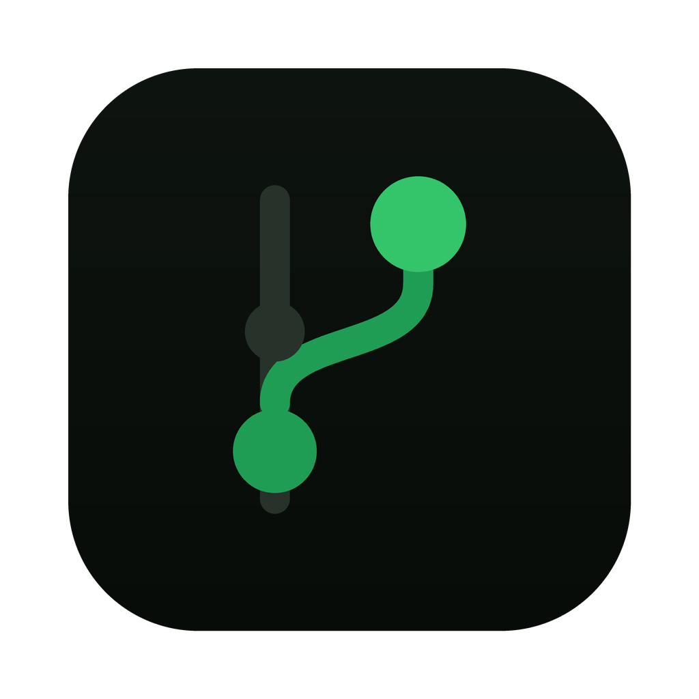
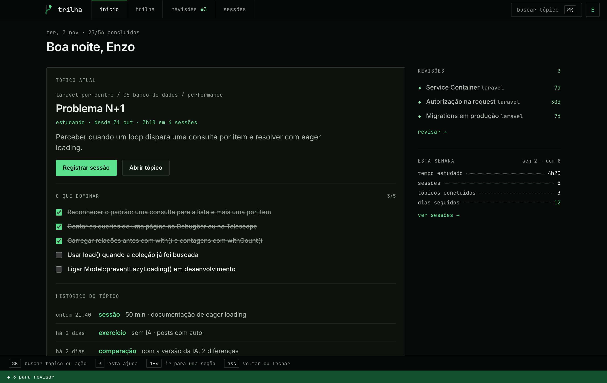
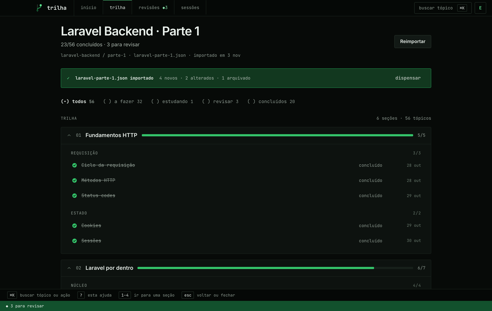
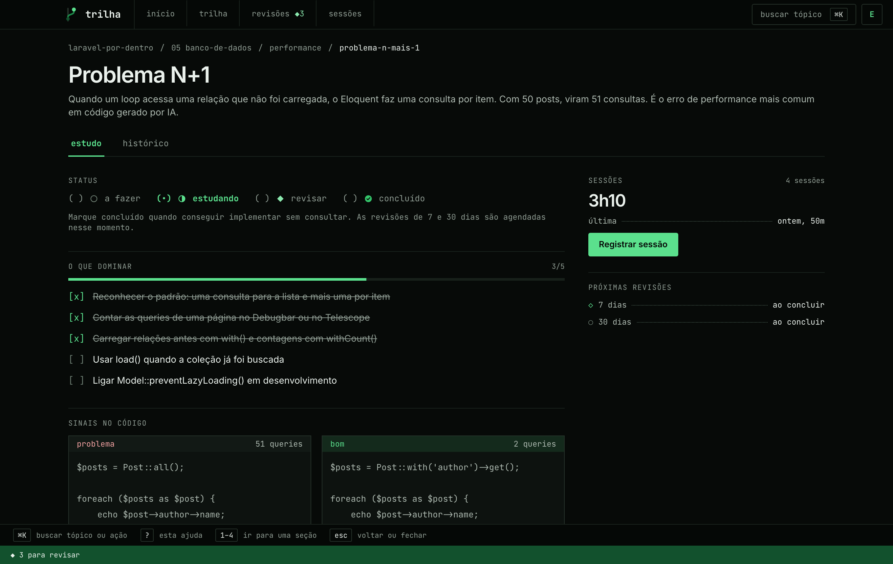
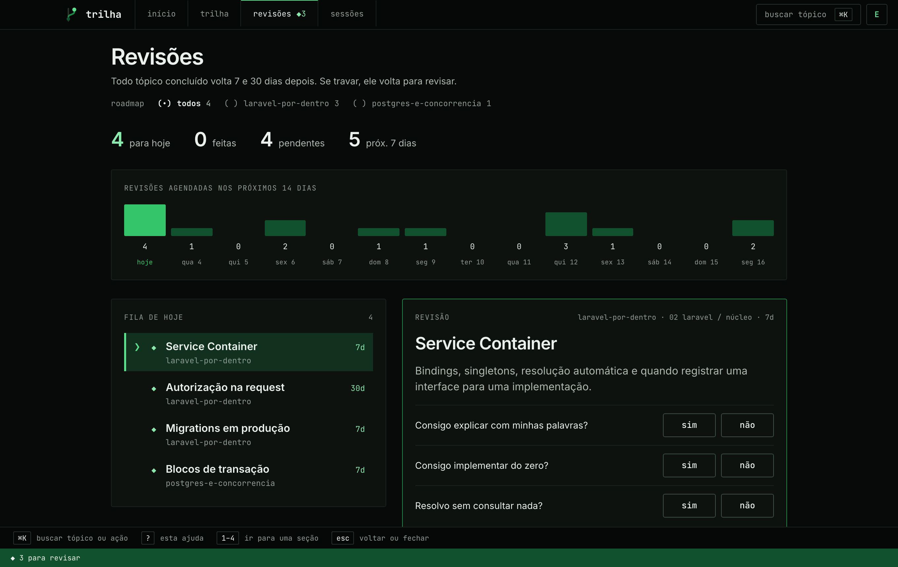
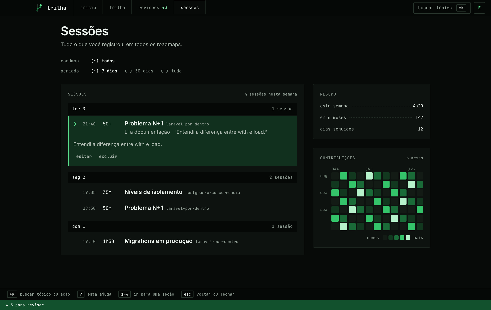
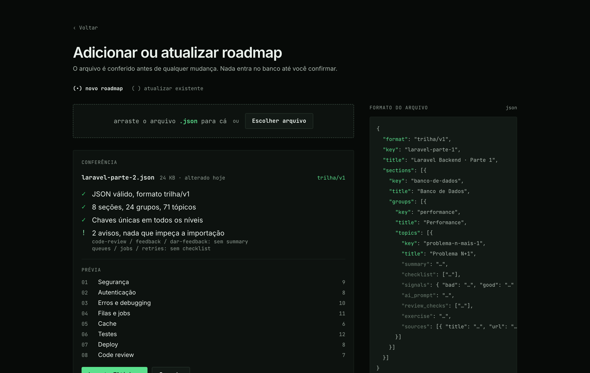
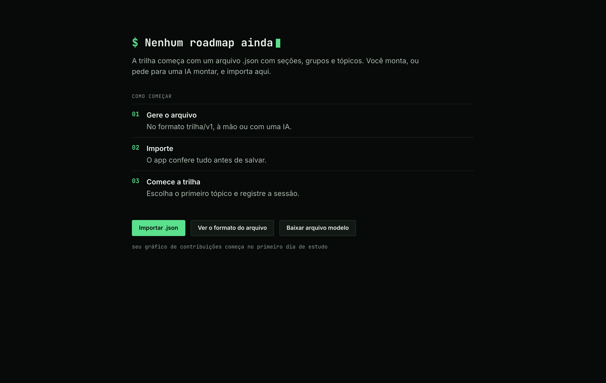

<p align="center">
  
</p>

<h1 align="center">trilha</h1>

<p align="center">
  Um app pessoal de desktop para seguir um roadmap de estudos tópico a tópico, registrar suas sessões e manter as revisões em dia.
</p>

<p align="center">
  <a href="https://github.com/enzobreisc/trilha/actions/workflows/tests.yml"></a>
  
  
  
  
</p>

<p align="center">
  <a href="README.md">English</a> · Português
</p>



> [!NOTE]
> **A v0.1.0 é um protótipo de interface.** Todas as telas estão prontas e navegáveis, mas mostram dados de exemplo. A parte em Laravel (models, actions, lógica de importação) é a próxima etapa, então nada é salvo ainda.

## Por quê

Estudar por um roadmap com uma IA do lado faz você se sentir produtivo sem aprender muito. A trilha deixa cada tópico honesto: uma lista do que dominar, os sinais de código bom e ruim, um prompt para a IA com as perguntas para conferir a resposta, e um exercício para fazer **sem** IA. Um tópico só conta como concluído quando você consegue implementar sem consultar, e aí ele volta para revisão depois de 7 e 30 dias.

## Funcionalidades

- **Roadmaps a partir de um arquivo.** Um roadmap é um `.json` com seções, grupos e tópicos ([formato](#o-arquivo-de-roadmap)). O app confere o arquivo antes de salvar qualquer coisa e consegue atualizar um roadmap existente com um arquivo mais novo, mostrando o que foi adicionado, alterado e arquivado.
- **Vários roadmaps ao mesmo tempo.** Troque entre eles pela barra do topo e acompanhe o progresso de cada um.
- **Visão da trilha.** Todos os tópicos com seu status (a fazer, estudando, revisar, concluído), filtros por status e tópicos arquivados à parte.
- **Página do tópico.** O que dominar, sinais no código, um prompt para a IA com o que conferir, um exercício sem IA, anotações em Markdown, fontes e uma aba de histórico.
- **Revisões espaçadas.** Concluir um tópico agenda revisões em 7 e 30 dias, reunidas numa única fila de todos os roadmaps, com um calendário de 14 dias.
- **Sessões de estudo.** Registre tempo, atividade e anotações de um tópico, e veja o histórico agrupado por dia.
- **Gráfico de contribuições** dos seus dias de estudo, com totais da semana e dias seguidos.
- **Feito para o teclado.** `⌘K` busca tópicos e ações, `?` mostra os atalhos e `1`–`4` trocam de seção.
- **Interface bilíngue** em português e inglês.
- **Offline primeiro.** Tudo fica num banco SQLite local.

## Telas

| Trilha                                  | Tópico                                |
| --------------------------------------- | ------------------------------------- |
|  |  |

| Revisões                                  | Sessões                                   |
| ----------------------------------------- | ----------------------------------------- |
|  |  |

| Importar                                 | Primeiro uso                                  |
| ---------------------------------------- | --------------------------------------------- |
|  |  |

## O arquivo de roadmap

Um roadmap é um único arquivo JSON no formato `trilha/v1`. Você pode escrever à mão ou pedir para uma IA gerar a partir de um curso, um livro ou uma lista de assuntos.

```json
{
    "format": "trilha/v1",
    "key": "laravel-parte-1",
    "title": "Laravel Backend · Parte 1",
    "sections": [
        {
            "key": "banco-de-dados",
            "title": "Banco de Dados",
            "groups": [
                {
                    "key": "performance",
                    "title": "Performance",
                    "topics": [
                        {
                            "key": "problema-n-mais-1",
                            "title": "Problema N+1",
                            "summary": "…",
                            "checklist": ["…"],
                            "signals": { "bad": "…", "good": "…" },
                            "ai_prompt": "…",
                            "review_checks": ["…"],
                            "exercise": "…",
                            "sources": [{ "title": "…", "url": "…" }]
                        }
                    ]
                }
            ]
        }
    ]
}
```

As chaves (`key`) precisam ser únicas em todos os níveis. É por elas que um arquivo mais novo vai atualizar um roadmap mantendo o progresso dos tópicos que não mudaram.

## Destaques técnicos

- **Um app Laravel distribuído como app de desktop.** O [NativePHP](https://nativephp.com) empacota o PHP e o app no Electron, e uma interface Inertia + React roda dentro da janela.
- **i18n em que a chave é o texto original.** Os textos são escritos em português e traduzidos em [`lang/en.json`](lang/en.json); a checagem de tipos falha se faltar uma chave no React e um teste de feature falha se faltar uma chave no PHP.
- **Componentes pequenos e tipados.** Componentes de apresentação ficam separados dos que guardam estado, a lógica fica em hooks e o TypeScript roda sem `any`.
- **Design tokens num só lugar.** Cores, fontes e raios são variáveis de tema do Tailwind em [`resources/css/app.css`](resources/css/app.css), então as telas usam tokens em vez de hex soltos.
- **Portões de qualidade no CI.** Pest, PHPStan, Pint, lint e formatação do Vite+ e `tsc` rodam a cada push.

## Stack

| Camada    | Escolha                                  |
| --------- | ---------------------------------------- |
| Backend   | Laravel 13, PHP 8.4                      |
| Desktop   | NativePHP Desktop 2 (Electron)           |
| Banco     | SQLite                                   |
| Front end | Inertia 3, React 19, TypeScript          |
| Estilo    | Tailwind CSS 4                           |
| Qualidade | Pest, PHPStan, Pint, Vite+ lint/fmt, tsc |

## Instalação

Ainda não há build empacotado. Até o backend ficar pronto, rode a trilha a partir do código, como abaixo. Os builds para macOS vão ser anexados em [Releases](https://github.com/enzobreisc/trilha/releases).

## Desenvolvimento

Requisitos: PHP 8.4, Composer, Node 22+.

```bash
composer setup   # instala dependências, gera o APP_KEY, migra e faz o build
composer dev     # inicia o ambiente de desenvolvimento
```

| Comando               | O que roda                      |
| --------------------- | ------------------------------- |
| `composer test`       | Pint, PHPStan e Pest            |
| `npm run check`       | lint e formatação do front end  |
| `npm run types:check` | checagem de tipos do TypeScript |

## Estrutura do projeto

```
app/                    aplicação Laravel
resources/css/app.css   design tokens e fontes
resources/js/
  pages/                uma página Inertia por tela
  layouts/              casca do app: barra do topo, atalhos, rodapé
  components/           interface agrupada por funcionalidade
    ui/                 blocos compartilhados (botões, rótulos, linhas…)
    overlays/           busca, troca de roadmap, menu do perfil, atalhos
  hooks/                lógica extraída dos componentes
  lib/sample/           dados de exemplo usados até o backend ficar pronto
lang/en.json            traduções para inglês
tests/Feature/          testes de comportamento por funcionalidade
```

## Licença

[MIT](LICENSE)
